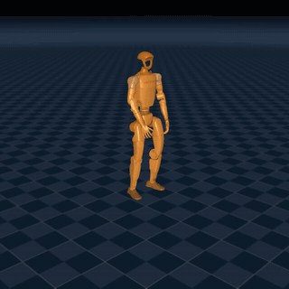
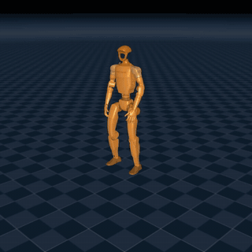
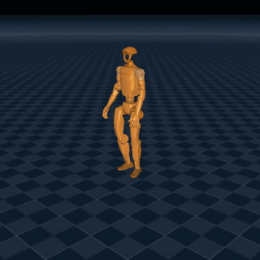
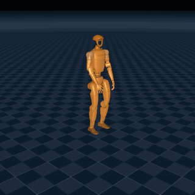
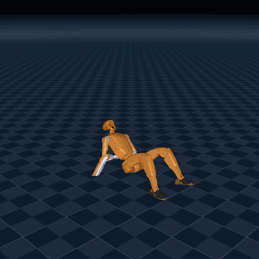
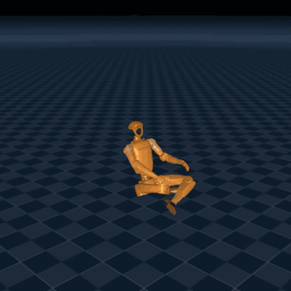
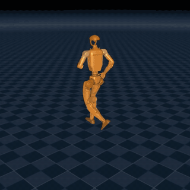
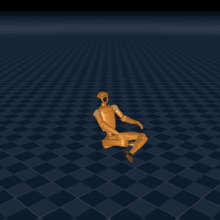

# SuperMimic on Newton

An unofficial reproduction of *SuperMimic: Scaling Humanoid Whole-Body Control with One Differentiable World
Model* (arXiv 2610.28480) on the Unitree G1, built on [Newton](https://github.com/newton-physics/newton) and
MuJoCo Warp, the simulator used in the paper.

The repository provides a vectorized motion-tracking environment, a PPO-Sim baseline, the full SuperMimic training
loop (a learned dynamics model with backpropagation through imagined rollouts), and a benchmark that runs in both
the training simulator and stock MuJoCo.

## Results

The reported policy is a 23-DoF G1 trained for 60,000 iterations on 121,567 BONES-SEED clips (248 h of motion). The
run used 4096 environments on one RTX 3090 and took about 10 h, with about 0.6 billion simulator steps. This is
well short of the paper's 320,000 iterations, so these figures describe this run and are not a comparison with
the paper.

### Replays

Grey is the simulated robot and orange is the reference motion. Each clip starts from its first frame under the
benchmark protocol. *Score* is the normalized return; the percentiles rank clips that did not fail.

| | | |
|---|---|---|
|  |  |  |
| Dance with head accents, median, score 0.984 | Door knob, median, score 0.984 | Sideways jog, 10th percentile, score 0.939 |
|  |  |  |
| Hip-hop dance, 1st percentile, score 0.862 | Seated arm motion, lowest score without a fall, 0.462 | Cross-legged sit, failed in both passes, score 0.720 |

The same policy in stock MuJoCo on three harder clips. All three complete, including a sitting motion that failed in
one of the two passes in the training simulator:

| | | |
|---|---|---|
|  |  |  |
| Hip-hop dance, score 0.924 | Jog with spin, score 0.799 | Cross-legged sit, score 0.806 |

### Benchmark

Mean normalized return and failure counts for the 60,000-iteration checkpoint:

| Simulator | Clips | Failed | Failure rate | Normalized return |
|---|---:|---:|---:|---:|
| Newton + MuJoCo Warp, pass 1 | 121,567 | 23 | 0.019% | 0.974 |
| Newton + MuJoCo Warp, pass 2 (shuffled) | 121,567 | 24 | 0.020% | 0.974 |
| Newton + MuJoCo Warp | 1,000 subset | 0 | 0% | 0.975 |
| Stock MuJoCo (CPU) | 1,000 subset | 0 falls, 1 solver failure | 0.1% | 0.975 |

In pass 1 the median return was 0.984, the 10th percentile 0.939 and the 1st percentile 0.862. The two simulators
return the same mean on the 1,000-clip subset, although that subset cannot resolve a failure rate near 0.02%. The
single MuJoCo failure is numerical: the solver produced non-finite accelerations at a hand-to-shoulder self-contact
while the robot was upright, with a return of 0.961 up to that point. It recurred at the same time step with physics
steps of 5, 2.5 and 1 ms.

Failures concentrate in seated and getting-up motions. The two passes share 21 of 26 distinct failed clips, and 16 of
those 21 are sitting or standing up from the ground.

These figures supersede an earlier evaluation that scored 0.964 with 91 failures. That run was affected by a bug that
shifted every environment's observation history whenever any environment reset; the bug was fixed in the environment,
and the policy was not retrained.

### Training stability

An initial 23-DoF run collapsed as training continued: its return on the 1,000-clip subset fell from 0.928 at 5,000
iterations to 0.504 at 40,000. The causes were critic overestimation and drift in the observation normalizers.
Three changes addressed this:

1. **Bounded value estimates.** Critic predictions are capped at the attainable return,
   $V_{\max} = r_{\max}/(1-\gamma) = 0.1/(1-0.99) = 10$.
2. **Fixed input scales.** Policy, critic and world-model inputs use fixed scales instead of running statistics.
3. **Frozen output statistics.** World-model output statistics stop updating after 5,000 iterations.

An ablation on the 1,000-clip subset shows which scaling is required:

| Normalization | Return at 5k | Return at 10k |
|---|---:|---:|
| Running statistics, frozen at 5k | 0.929 | 0.946 |
| Fixed input scales (default) | 0.937 | 0.954 |
| No input scaling | 0.922 | not run |
| No input or world-model output scaling | 0.801 | not run |

World-model output scaling is essential, whereas input scaling needs no running statistics.

## Method

### Task

Control runs at 50 Hz over four 5 ms physics substeps. The policy outputs a joint position offset, tracked by
low-gain PD actuators:

$$q^{\mathrm{sp}} = q_0 + \Delta q_0 + \alpha\,a, \qquad \alpha = \frac{0.25\,\tau_{\max}}{k_p}$$

where $\Delta q_0$ is the joint calibration offset. Each joint has a natural frequency of 10 Hz and a damping ratio
of 2 about its reflected armature.

| Quantity | Dimension (29 / 23 DoF) | Definition |
|---|---|---|
| Proprioception $\bar{o}$ | 93 / 75 | Joint position and velocity, IMU angular velocity, projected gravity, previous action |
| Policy input | 10 frames | Last 10 noisy proprioceptive frames (Table A.1) |
| Goal | 10 × 67 / 10 × 55 | Next 10 reference frames: joint state, root position and 6D orientation in the root frame |
| State $s$ | 71 / 59 | Root pose and twist, joint positions and velocities |
| Context $\xi$ | 33 / 27 | Friction $\sim U[0.3, 1.2]$, joint offsets $\sim U[-0.01, 0.01]$, torso centre-of-mass offset |

The reward is the BeyondMimic tracking reward with the self-collision penalty removed and a joint-limit weight of
−2. Each tracking term has the form below, and every term is scaled by $\Delta t = 0.02$, so the maximum is 0.1 per
step:

$$r_i = w_i \exp\!\left(-\frac{e_i}{\sigma_i^2}\right)\Delta t$$

An episode terminates when the root height error exceeds 0.25 m or the tilt error exceeds 0.8, and truncates at the
end of the clip. Context is resampled each episode, and there are no root-velocity pushes.

### Training

Each iteration collects simulator steps into a replay buffer, fits the world model $f_\omega$ on $k=8$ step
windows, updates the policy by backpropagation through 4096 imagined rollouts of horizon $H=32$, and fits the critic
to GAE($\lambda = 0.95$) targets. Hyperparameters follow Table A.5.

Only the dynamics are learned. Observation, goal, reward and termination are analytic functions of the predicted
state, shared with the simulator through `supermimic/envs/tracking.py`. Termination is relaxed so that survival
remains differentiable, where $e_h$ and $e_\theta$ are the height and tilt errors:

$$\hat{d} = 1 - \sigma\!\left(\frac{0.25 - e_h}{0.02}\right)\sigma\!\left(\frac{0.8 - e_\theta}{0.05}\right)$$

Resets are drawn from 1 s motion bins $b$ by return-based sampling (Appendix D.1), with $\bar{G}_b$ the bin's recent
return and $w_b$ its accumulated past weight:

$$p(b) = 0.5\,\mathcal{U}(b) + 0.4\,\mathrm{softmax}\!\left(-25\,\frac{\bar{G}_b}{G_{\max}}\right) + 0.1\,w_b$$

### Deviations from the paper

| Topic | This repository | Paper |
|---|---|---|
| World-model heads | Analytic, with a differentiable FK | Learned or analytic heads are allowed; termination is learned |
| Input and output scaling | Fixed input scales, value clamp, frozen output statistics | Not specified in this form |
| Anchor body | Pelvis (`anchor_body`) | "Root (pelvis)"; BeyondMimic used `torso_link` |
| Reset perturbation | BeyondMimic's ranges | Not stated |
| Sampler details | 250-step windows; timeouts normalized by attainable return | Not stated |
| Robot | 23 DoF available (`g1_23dof`) in addition to 29 DoF | 29 DoF |
| Soft termination widths | 0.02 and 0.05, chosen here | Not applicable |
| Self-collisions | Enabled, using MJCF convex hulls | Only the penalty is removed |

## Installation

The project uses Python 3.12 with PyTorch 2.11, Newton 1.2, MuJoCo 3.8 and MuJoCo Warp 3.8.
[RLAlg](https://github.com/XZDang13/RLAlg) is also required. Training expects a CUDA GPU; one run on the full
library uses about 23 GB of GPU memory.

```bash
conda activate isaaclab
pip install -e . --no-deps
```

## Usage

### Verification

```bash
python scripts/make_test_motions.py
python scripts/test_env.py --num-envs 4096 --policy ref
pytest tests
```

### Training

```bash
python scripts/train_supermimic.py --robot g1_23dof --motions data/motions/bones_seed_23dof.npz \
    --num-envs 4096 --iterations 70000 --save-interval 2500 --log-dir runs/supermimic
python scripts/train_ppo.py --motions data/motions/test --num-envs 4096 --iterations 30000 --log-dir runs/ppo
```

### Evaluation

The benchmark follows Appendix F. Each clip plays once from its first frame with deterministic actions and friction
1.0, without domain randomization, observation noise or reset perturbation. A clip fails if the training termination
triggers before it ends.

```bash
# training simulator
python scripts/eval_policy.py runs/supermimic/model_60000.pt \
    --motions data/motions/bones_seed_23dof.npz --out results.json

# stock CPU MuJoCo, compared with the results above on the same clips
python scripts/eval_sim2sim.py runs/supermimic/model_60000.pt \
    --motions data/motions/eval1000_23dof.npz --results results.json --out sim2sim.json

# interactive viewer; failed clips first
python scripts/view_policy.py runs/supermimic/model_60000.pt \
    --motions data/motions/bones_seed_23dof.npz --results results.json --grid 4
```

`scripts/render_sim2sim.py` writes MP4 replays of the same MuJoCo rollouts with the reference as an orange ghost:

```bash
python scripts/render_sim2sim.py runs/supermimic/model_60000.pt \
    --motions data/motions/eval1000_23dof.npz --clip CLIP_NAME --out runs/sim2sim_replays
```

The sim-to-sim evaluator builds the robot from its MJCF with the training gains, armature, effort limits and substep.
Contacts, joint limits and solver settings otherwise stay at MuJoCo's values.

### Motion data

```bash
python scripts/prepare_bones_seed.py --num-clips 300 --out data/motions/bones_seed
```

Clips are retargeted with [retargeter](https://github.com/XZDang13/retargeter). `scripts/pack_motions.py` packs
clips into a single file for large libraries, and `scripts/convert_csv_motion.py` converts retargeted CSV files.
BONES-SEED data and anything derived from it is licensed, and `data/` is excluded from this repository.

## Repository structure

| Path | Contents |
|---|---|
| `supermimic/robots/` | G1 variants, actuator parameters, default pose, tracked bodies |
| `supermimic/motion/` | Motion library and return-based reset sampler |
| `supermimic/envs/` | Vectorized environment and shared task terms |
| `supermimic/wm/` | World model, differentiable FK, replay buffer, policy, trainer |
| `supermimic/ppo/` | PPO-Sim model and trainer |
| `supermimic/eval.py` | Benchmark settings and checkpoint loading |
| `supermimic/sim2sim.py` | Stock MuJoCo evaluator |
| `scripts/` | Training, evaluation, viewing and data preparation |
| `tests/` | Environment, world-model and sim-to-sim parity tests |
| `docs/notes.md` | Engineering notes, early runs and performance history |

## Known limitations

- **Evaluation varies slightly between runs.** MuJoCo Warp orders contacts and constraints differently from run to
  run, so identical states diverge after the first physics step. The effect is small: the two shuffled passes agree
  on the mean return, differ by 0.0001 per clip on average, and disagree on 5 of 26 failed clips. Clips near failure
  can therefore flip between runs.
- **Training predates the observation-history fix.** The checkpoint was trained with the bug in simulator data
  collection, although imagined rollouts rebuilt their history correctly. Return figures under *Training stability*
  were also measured with the bug, so they are comparable with each other but not with the table above.
- **The training simulator has two floor planes.** Newton's model holds both the MJCF floor and an added ground plane at
  the same height, which doubles ground contacts. Friction randomization is unaffected. This should be fixed before the
  next training run.
- **MuJoCo solver failures.** Stock MuJoCo can fail numerically on self-contacts. `eval_sim2sim.py` counts these
  as failed clips and reports them separately from falls.
- **No hardware validation.** The sim-to-sim check runs without sensor noise, latency or randomization, and both
  simulators share MuJoCo's contact model, so it does not establish real-robot performance.

## Roadmap

1. Fix the duplicate floor and retrain.
2. Improve seated and getting-up motions.
3. Score the full library in stock MuJoCo and resolve the self-contact solver failure.
4. Train towards the paper's 320,000 iterations and add further motion data.

## Acknowledgements

Actuation, rewards and hyperparameters follow BeyondMimic and the SuperMimic paper. The PPO-Sim baseline uses
[RLAlg](https://github.com/XZDang13/RLAlg) losses and follows the
[RLDemos](https://github.com/XZDang13/RLDemos) PPO trainer.
